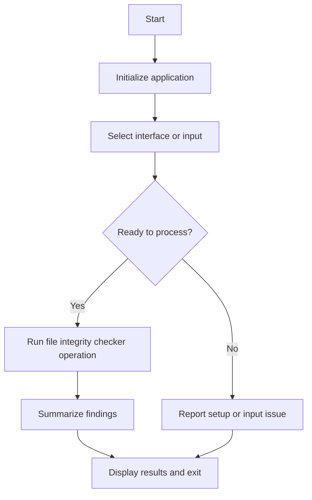

# 📁 File Integrity Checker


## Get this repository

Clone the current project (this repository's canonical GitHub URL), then follow the installation and usage steps below.

```bash
git clone https://github.com/cyberworlduniversity/file_integrity_checker.git
cd file_integrity_checker
```

> **Tool #18 in the Security Toolkit by [hemanathan115](https://github.com/hemanathan115)**

A Python-based command-line tool that **generates and verifies file hashes** to detect unauthorized file modifications (tampering). Perfect for monitoring critical system files, configuration files, or any sensitive data.

---

## 🚀 Features

| Feature | Description |
|---|---|
| 🔐 Multi-Algorithm Support | MD5, SHA1, SHA256, SHA512 |
| 📂 Directory Scanning | Scan entire directories (optionally recursive) |
| 🗄️ JSON Database | Stores baseline hashes in a local JSON file |
| 🔍 Tamper Detection | Instantly detect modified, missing, or new files |
| 👁️ Monitor Mode | Continuously watches files at set intervals |
| 🎨 Colored Output | Clear, color-coded terminal output |
| ⚙️ CI/CD Friendly | Non-zero exit code on tamper detection |

---

## 📦 Installation

### 1. Clone the repository

```bash
git clone https://github.com/cyberworlduniversity/file_integrity_checker.git
cd file_integrity_checker
```

### 2. Install dependencies

```bash
pip install -r requirements.txt
```

---

## 🛠️ Usage

### Generate Baseline Hashes

```bash
python file_integrity_checker.py --generate file.txt mydir/
```

Recursively scan a directory:

```bash
python file_integrity_checker.py --generate mydir/ --recursive
```

Use a different algorithm (default is SHA256):

```bash
python file_integrity_checker.py --generate file.txt --algorithm sha512
```

---

### Verify File Integrity

Verify specific files:

```bash
python file_integrity_checker.py --verify file.txt
```

Verify **all** files tracked in the database:

```bash
python file_integrity_checker.py --verify
```

---

### Monitor Mode (Continuous Watching)

Watch all tracked files every 30 seconds:

```bash
python file_integrity_checker.py --monitor --interval 30
```

---

### List Database Entries

```bash
python file_integrity_checker.py --list
```

---

### Remove a File from Database

```bash
python file_integrity_checker.py --remove file.txt
```

---

### Use a Custom Database File

```bash
python file_integrity_checker.py --generate file.txt --db my_hashes.json
```

---

## 📊 Sample Output

```
╔══════════════════════════════════════════════════════╗
║         📁  FILE INTEGRITY CHECKER  📁               ║
║      Detect File Tampering Using Hashing             ║
║      GitHub: github.com/hemanathan115               ║
╚══════════════════════════════════════════════════════╝

[*] Verifying file integrity...

  [OK]       /home/user/config.txt
  [TAMPERED] /home/user/data.json
             Stored : a3f1bc...
             Current: 9d72ef...
  [MISSING]  /home/user/secret.key  ← File not found!

══════════════════════ SUMMARY ══════════════════════
  ✓ Intact   : 1
  ✗ Tampered : 1
  ⚠ Missing  : 1
  + New      : 0
═════════════════════════════════════════════════════
```

---

## ⚙️ All Options

```
usage: file_integrity_checker [-h]
  (--generate PATH [PATH ...] | --verify [PATH ...] | --monitor | --list | --remove PATH)
  [--algorithm {md5,sha1,sha256,sha512}]
  [--db DB] [--recursive] [--interval INTERVAL]

Options:
  --generate  PATH      Generate/update hashes for file(s) or directory(ies)
  --verify    PATH      Verify integrity; omit PATH to check all in DB
  --monitor             Continuously monitor for changes
  --list                List all hash database entries
  --remove    PATH      Remove entry from database
  --algorithm ALGO      Hash algorithm: md5, sha1, sha256, sha512 (default: sha256)
  --db        FILE      Custom database file path (default: hash_database.json)
  --recursive           Recursively scan directories
  --interval  SECONDS   Monitor interval in seconds (default: 60)
```

---

## 🔒 How It Works

1. **Baseline Phase** — Run `--generate` to compute and store hashes of your files in `hash_database.json`.
2. **Verification Phase** — Run `--verify` to recompute hashes and compare against the stored baseline.
3. **Detection** — Any mismatch means the file was **modified**. Missing files and new (untracked) files are also reported.

---

## 📁 Project Structure

```
file-integrity-checker/
├── file_integrity_checker.py   # Main tool
├── requirements.txt            # Dependencies
└── README.md                   # Documentation
```

---

## 🧰 Part of the Security Toolkit

This tool is **#18** in a growing collection of Python security tools. Check out the full kit at [github.com/hemanathan115](https://github.com/hemanathan115).

---

## 📄 License

MIT License — free to use, modify, and distribute.

---

*Built with ❤️ by [hemanathan115](https://github.com/hemanathan115)*


## Repository Quick Start

Clone the canonical repository:

```bash
git clone https://github.com/cyberworlduniversity/file_integrity_checker.git
cd file_integrity_checker
```

### Requirements and installation

- Install Python 3.10+ and pip.

```bash
python -m pip install -r requirements.txt
```

### Build / run

```bash
file_integrity_checker.py
```

```bash
python file_integrity_checker.py
```

### Validation

```bash
python -m compileall -q .
```

Use the tool only on files you are authorized to inspect; keep baseline hashes protected.

### Program flow


